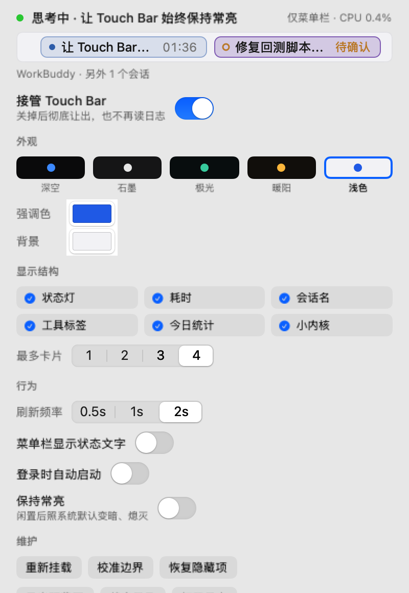
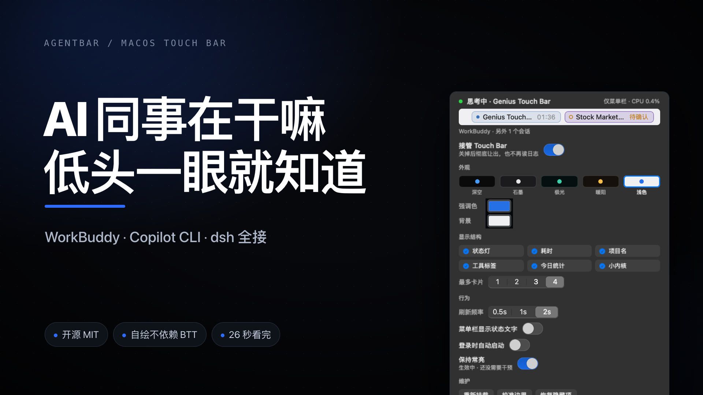

# AgentBar

**AI 同事在干什么，低头一眼就知道。**
*Know what your AI agents are doing — one glance at the Touch Bar.*


<sub>点菜单栏图标就打开这块面板窗口 —— 能拖、能最小化、能放大，开关/配色/显示结构都在里面。</sub>



---

## 宣传片 / Promo

[](docs/promo.mp4)

28 秒，无旁白只有配乐：多进程卡片 → 待确认 → 一点跳回 → 控制面板。

---

## 这是什么 / What it is

AgentBar 占用你 MacBook 的 Touch Bar，把「哪个 AI 正在干活、干到哪一步、要不要你点头」摊在键盘上方。

它自己就是 Touch Bar 的宿主 App，不依赖 MTMR / BetterTouchTool / Pock，也不花钱。

*AgentBar takes over your MacBook Touch Bar and shows which AI agent is working, what it's doing, and whether it's waiting on you. It is its own Touch Bar host — no MTMR, no BetterTouchTool, no Pock, no license fee.*

---

## 三个界面 / Three views

| 场景 | 画面 |
|---|---|
| 单个 agent 在跑 |  |
| 多个 agent 并行 |  |
| 全都闲下来 |  |

- **单任务**：状态灯 → 状态词 → 本轮耗时 → 项目名 → 当前工具，右侧是今日累计
- **多任务**：每个 agent 一张卡片，底色按软件区分（WorkBuddy 蓝 / Copilot 紫 / dsh 青绿），等你确认的那张会变成琥珀色并描边加粗，**点哪张进哪个**
- **卡片顺序**：从左到右固定按 **需要处理 → 进行中 → 已完成** 排；同一组里按这一轮的开始时间先后排，时间一样就按会话 ID 定死。排序不看「最近更新」，所以卡片不会隔几秒就换位置
- **空闲**：今日轮次、时长、消耗，外加一只在 Touch Bar 上散步的小内核

**长按任意卡片**可以把它「只看这个 / 隐藏 2 小时 / 归档 / 取消」；短按仍是跳回会话。隐藏到期自动恢复，全都藏在菜单栏的「恢复被隐藏 / 归档的项目」里。

---

## 控制面板 / Control panel

点菜单栏的闪电图标（右键是传统菜单）打开一个**普通窗口**：带标题栏和红黄绿按钮，能拖动、能最小化、能缩放，位置和大小会被记住。改完立刻生效，不用重启：

| 分区 | 能做什么 |
|---|---|
| **顶部** | 实时预览条（和 Touch Bar 用同一套渲染器画）、当前状态一句话摘要 |
| **开关** | 接管 / 放行 Touch Bar。关掉后彻底让出、也不再读日志，CPU 归零 |
| **外观** | 五套主题（深空 / 石墨 / 极光 / 暖阳 / 浅色）+ 自定义强调色、背景色；浅色底会自动把文字与语义色压深 |
| **显示结构** | 状态灯 / 耗时 / 项目名 / 工具标签 / 今日统计 / 小内核，逐项开关；多卡最多显示 1–4 张 |
| **行为** | 刷新频率 0.5s / 1s / 2s、菜单栏是否带文字、登录时自动启动、保持常亮 |
| **维护** | 重新挂载、校准右侧边界、恢复被隐藏项、导出预览图、打开状态目录 / 日志、立即刷新 |

窗口关掉不等于退出 —— App 继续待在菜单栏。再双击一次 App 图标，窗口会重新出现（不是「点了没反应」）。

主题是**全局**的：Touch Bar、预览条、面板自己看的是同一份配置（`~/.agentbar/config.json`）。

*Click the menu bar icon to open a regular window: on/off, themes and custom colors, which elements to show, refresh rate, autostart, and maintenance actions. It can be moved, minimized and resized, and everything applies instantly.*

---

## 保持常亮 / Keep the Touch Bar lit

系统默认行为：停手约 60 秒后，Touch Bar 会分几档调暗，再久一点彻底熄灭，得先摸一下才亮回来 —— 想瞄一眼状态的话，这挺烦。

面板「行为」里的**保持常亮**就是干这个的（默认开），两条路按可用性依次降级：

| 顺序 | 做法 | 条件 |
|---|---|---|
| ① 写背光档位 | 每 0.5 秒读档位（0 = 原亮度），被调暗就 `dimToStep(0)` 按回去、被关掉就 `turnOn` | 系统肯给 `getDFRDisplayID` 句柄 |
| ② 模拟输入保活 | 闲置满 25 秒投一个**零位移鼠标事件**，把闲置计时器顶回去 | 需要「辅助功能」权限 |

两条路都不在主屏睡着 / 屏幕锁着时动手 —— 那会儿变暗是应该的；关掉开关会把接管前的档位还回去。
另外档位能读，所以面板已经变暗时会自动换成**高对比配色**（深底拉纯白、浅底压近黑），暗着也能读出字。

**本机实测**（2018 款 15 寸 Intel / macOS 15.8.3）：`getDFRDisplayID` 返回 -1，第①条路走不通，
各种写入一律被拒 ——

| 探过的路 | 结果 |
|---|---|
| `DFRBrightnessClient -dimToStep:` / `-turnOn` | 被拒（系统不给第三方句柄） |
| `DFRFoundation` 的 `DFRSetDimmingStep` / `DFRDSetDimmingStep` | 无效 |
| SkyLight 的 `SLSDFRSetDimmingStep`（WindowServer 侧） | 无效 |
| 重新挂载 system-modal 条 | 无效（档位一直停在 4） |
| `caffeinate -u` 声明用户活动 | 无效（不是系统 idle 计时器） |

所以这台机器走第②条。实测：开之前档位 20 秒爬到 **4** 就不再下来；开之后连续 2 分钟采样始终是 **1**（≈原亮度）。

**授权为什么能不反复**：TCC 是按「指定要求」记账的。ad-hoc 签名时指定要求 = 二进制指纹，每次编译都变，
授权立刻作废（列表里勾着也不算数）；换成固定证书后，指定要求 = `bundle id + 证书根`，重装照旧有效。

```bash
make sign-cert    # 建固定自签名证书 + 导入钥匙串 + 标为可信（幂等），私钥在 ~/.agentbar/signing/
make install      # 自动优先用它签，没有证书才退回 ad-hoc
```

坑在这里：**只导入不标可信没用** —— 证书进不了信任链时系统认为签名无效，TCC 会退回按指纹记账，
于是勾了复选框也不生效（这就是「明明授权了还一直问」的原因）。`make sign-cert` 里的
`security add-trusted-cert` 那一步不能省。换新机器时先跑它，再 `make install`。

`agentbar backlight` 可以随时看当前档位 —— `dimmingStep 4` 就是已经被调到最暗一档。

*The system dims the Touch Bar after ~60 s idle and later turns it off. The **Keep lit** toggle polls the private dimming step and pushes it back to 0. Where macOS refuses to hand out the display handle, the panel says so rather than pretending.*

---

## 支持的 Agent / Supported agents

| Agent | 数据来源 | 识别能力 |
|---|---|---|
| **WorkBuddy**（桌面版） | `~/.workbuddy/projects/**/*.jsonl` | 思考 / 工具 / 待确认 / 完成，可深链跳回具体会话 |
| **CodeBuddy CLI** | 同上格式（`~/.codebuddy`） | 同上 |
| **GitHub Copilot CLI** | `~/.copilot/session-state/*/events.jsonl` | 思考 / 工具 / 完成 / 出错 |
| **dsh**（DeepSeek Harness） | `~/.dsh/storages/session_projcache/**` | 思考 / 工具 / 待确认 / 完成，含标题与模型 |
| **任何其它工具** | `agentbar report` / `agentbar hook` / 自定义 provider 脚本 | 由上报方决定 |

适配器是**只读**的：解析本地会话日志，不注入任何东西，不改被监控工具的配置。

*All adapters are read-only: they parse local session logs and never modify the tools they watch.*

---

## 安装 / Install

需要 macOS 13+ 和装有 Touch Bar 的 MacBook Pro。

```bash
git clone https://github.com/patrickb46-hub/agentbar-touchbar.git
cd agentbar-touchbar
make install          # 编译并装到 /Applications/AgentBar.app（访达 → 应用程序）
open -a AgentBar      # 或者直接在访达里双击 AgentBar
```

> 想装到自己的用户目录：`make install PREFIX=$HOME/Applications`。

启动后**菜单栏会出现一个闪电图标**——它就是 AgentBar 本体（没有窗口，不占 Dock）。
点它开面板；同时键盘上方的 Touch Bar 会被接管。

可选：

```bash
make autostart        # 登录时自动启动（也可以在面板里一键开关）
make uninstall        # 卸载
```

> 本项目不做 Apple 公证（本地编译的副本一般不会被拦）。万一提示「无法验证开发者」：
> 在 Finder 里**右键 → 打开**，或系统设置 → 隐私与安全性 → 「仍要打开」。
> 也可以直接用 `make run` 前台跑，不装 App。
>
> 双重启动不会有第二个图标：App 是常驻的单实例菜单栏程序，已经在跑的时候再双击一次，
> 系统只会把它唤到前台——看起来像「没反应」，其实本来就在工作。

---

## 第一次用：校准右侧边界 / Calibrate once

Touch Bar 右边有亮度、音量和 Siri 一小段控制条，它会盖住画布，而不同人配置不一样宽。AgentBar 会自动读面板宽度（`_NSFunctionRowPanel`），但控制条那一截需要你点一下：

**菜单栏图标 → 校准右侧边界 → 点一下 Touch Bar 上最右可用位置**

结果写进 `~/.agentbar/config.json`。以后改了控制条（比如把 Siri 拿掉），再校一次即可。

*The Control Strip on the right (brightness / volume / Siri) overlaps the canvas and its width varies. AgentBar reads the panel width automatically; the Control Strip part is one tap: menu bar icon → Calibrate → tap the rightmost usable spot.*

---

## 隐私 / Privacy

- 只读本地日志文件，**不联网**、不上传、无遥测
- 只解析 `type` / `timestamp` / 工具名 / 工作目录 / token 计数
- **不读取**你的提问与模型回复正文
- 所有状态都落在 `~/.agentbar/`，删掉即干净

*Local files only. No network, no telemetry, no prompt or response content — only event types, timestamps, tool names, working directories and token counts.*

---

## 接入你自己的工具 / Bring your own agent

三种接法，从轻到重：

```bash
# 1. 一行命令上报
agentbar report --provider mytool --state tool --tool Bash --cwd "$PWD"

# 2. hook 模式，从 stdin 读 JSON（兼容 Claude Code / Codex / WorkBuddy 的 hook 格式）
echo '{"hook_event_name":"PreToolUse","tool_name":"Bash","session_id":"abc"}' | agentbar hook

# 3. 写一个 provider 脚本，放在 ~/.agentbar/providers/ 下，每 2 秒被调用一次
```

协议、状态枚举和完整示例见 **[docs/PROVIDERS.md](docs/PROVIDERS.md)**。

---

## 命令行 / CLI

```bash
agentbar                     # 启动（菜单栏 App + 接管 Touch Bar）
agentbar render --multi      # 把界面渲染成 PNG，不需要 Touch Bar 硬件
agentbar render --theme paper     # 指定主题出图（midnight/graphite/aurora/amber/paper）
agentbar panel --out 面板.png      # 把控制面板离屏渲染成图片
agentbar dump                # 以 JSON 打印当前识别到的所有 agent
agentbar bench               # 性能基准：量一次刷新要多少毫秒
agentbar selftest --real     # 状态机自检（15 条夹具 + 真实日志回放）
agentbar backlight           # 只读诊断 Touch Bar 背光（档位 / 亮灭 / 是否有句柄）
agentbar backlight --try     # 实测按一次 0 档，看系统收不收
agentbar probe --provider dsh --limit 5   # 调试：解析会话文件，忽略空闲过滤
agentbar audit <sessionId>   # 调试：这条会话现在是否在等你确认
agentbar report ...          # 上报一条状态
agentbar hook                # hook 模式
agentbar clean               # 清掉上报的状态文件
```

`agentbar dump` 和 `render` 都适合放进脚本或 CI 做回归。

---

## 已知限制 / Known limits

- **私有 API**：靠 `NSTouchBar` 的 system-modal 接口接管 Touch Bar。所有私有符号都做了存在性判断，缺了就降级成「只在菜单栏显示」，但 macOS 大版本升级仍可能失效
- **同一时间只能有一个 Touch Bar 宿主**：和 MTMR / BetterTouchTool / Pock 互斥，同时开会抢屏
- **WorkBuddy 升级可能改日志格式**：解析器对未知字段宽容，真变了会退回 `agentbar hook` 通道
- **「待确认」来自应用自己的审计日志**：WorkBuddy 会把每次工具调用的安全裁决写进 `~/.workbuddy/audit-log/`（`ask-matched` → 你点了才有 `approved`），AgentBar 读这个，不靠静默时长猜，长命令不会被误报
- **「保持常亮」可能要授权**：系统不给背光句柄时改走模拟输入，需要辅助功能权限。用 `make sign-cert` 建的固定证书签名后，重装不必重新授权；用 ad-hoc 签名则每次重装都要重来一次，详见上一节
- 只在 **2018 款 15 寸 Intel MacBook Pro（macOS 15.8）** 上实测过；13 / 16 寸的宽度是自动读取的，但没验证

---

## 性能 / Performance

「AI 在跑的时候风扇转起来」这件事排查过一轮，根因是**每隔 0.5 秒把每个会话日志的尾部（最多 2 MB）重读重解一遍**，
主线程上平均 253 ms/次，等于常驻半个核。现在的做法：

| 改动 | 效果 |
|---|---|
| 增量解析：每个日志文件记住 offset 与解析状态，只读新增的几行 | 文件没变就完全不碰磁盘 |
| `FileStamp`（stat）代替 `URLResourceValues` 判断「变没变」 | 几百个文件的检测降到毫秒级 |
| 目录列表按目录 mtime 缓存，`stat` 批量取 | 819 个会话文件不再每次全扫 |
| 审计日志做成「每个会话最后一条事件」索引 | 「待确认」判定从 O(文件) 变 O(1) |
| 今日统计按文件缓存合计 | 60 秒一次的重算从 359 ms 降到 ~10 ms |
| 扫描搬到后台串行队列 + 请求合并 | 主线程不再被 IO 卡住 |
| 只在画面真的变了才重画（签名比对） | 空闲时几乎不绘制 |
| Touch Bar 4 秒看护改为「先检查再挂载」 | 不再每 4 秒重挂一次（也不闪了） |

`agentbar bench` 实测（本机，819 个会话文件）:

```
重构前  扫描平均 253.4 ms（每 0.5 秒一次，主线程）
重构后  扫描平均   3.1 ms（每 1 秒一次，后台队列）
```

*The old loop re-read and re-parsed up to 2 MB of tail per session twice a second on the main thread (~253 ms/tick). Now each file is followed incrementally, directories are cached, and drawing happens only when the frame actually changes: ~3 ms per tick, off the main thread.*

---

## 开发 / Development

```bash
make preview        # 重新生成 docs/ 里的预览图（含控制面板）
make test           # 状态机自检（含真实日志回放）
make bench          # 性能基准
make run            # 前台跑，日志在 ~/.agentbar/agentbar.log
```

> 沙箱 / CI 里跑会撞上 SwiftPM 自己的 sandbox-exec，需要 `SWIFT_FLAGS=--disable-sandbox`。

代码结构：

```
Sources/AgentBar/
├── TouchBarHost.swift     私有 API 宿主（dlsym 全程 guard）
├── Renderer.swift         单块画布：Core Graphics 自绘 + 命中测试
├── BarView.swift          视图与点击（mouseDown + touchesBegan 双通道）
├── Theme.swift            主题（配色 + 浅色适配）
├── Panel.swift            菜单栏控制面板（SwiftUI）+ 预览条
├── Store.swift            多来源聚合、分组排序（需要处理 > 进行中 > 已完成）、今日统计
├── Config.swift           配置读写（含显示结构 / 主题 / 刷新频率）
├── LaunchAgent.swift      登录自启
├── Providers/
│   ├── WorkBuddy.swift    WorkBuddy / CodeBuddy 会话日志（增量解析）
│   ├── AuditLog.swift     审计日志：判断是否真的在等你确认
│   ├── CopilotDSH.swift   Copilot CLI 与 dsh
│   └── JSONLTail.swift    FileStamp / TailFollower / 目录缓存
├── SelfTest.swift         状态机自检（合成夹具 + 真实日志回放）
├── Bench.swift            性能基准
└── CLI.swift              report / hook / render / dump / probe / panel
```

---

## License

MIT © 2026 String255
