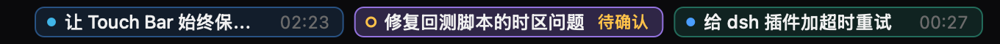

# AgentBar

**AI 同事在干什么，低头一眼就知道。**
*Know what your AI agents are doing — one glance at the Touch Bar.*



---

## 这是什么 / What it is

AgentBar 占用你 MacBook 的 Touch Bar，把「哪个 AI 正在干活、干到哪一步、要不要你点头」摊在键盘上方。

它自己就是 Touch Bar 的宿主 App，不依赖 MTMR / BetterTouchTool / Pock，也不花钱。

*AgentBar takes over your MacBook Touch Bar and shows which AI agent is working, what it's doing, and whether it's waiting on you. It is its own Touch Bar host — no MTMR, no BetterTouchTool, no Pock, no license fee.*

---

## 三个界面 / Three views

| 场景 | 画面 |
|---|---|
| 单个 agent 在跑 |  |
| 多个 agent 并行 |  |
| 全都闲下来 |  |

- **单任务**：状态灯 → 状态词 → 本轮耗时 → 项目名 → 当前工具，右侧是今日累计
- **多任务**：每个 agent 一张卡片，底色按软件区分（WorkBuddy 蓝 / Copilot 紫 / dsh 青绿），等你确认的那张会变成琥珀色并描边加粗，**点哪张进哪个**
- **空闲**：今日轮次、时长、消耗，外加一只在 Touch Bar 上散步的小内核

**长按任意卡片**可以把它「只看这个 / 隐藏 2 小时 / 归档 / 取消」；短按仍是跳回会话。隐藏到期自动恢复，全都藏在菜单栏的「恢复被隐藏 / 归档的项目」里。

**长按任意卡片**可以把它「只看这个 / 隐藏 2 小时 / 归档 / 取消」；短按仍是跳回会话。隐藏到期自动恢复，全都藏在菜单栏的「恢复被隐藏 / 归档的项目」里。

---

## 支持的 Agent / Supported agents

| Agent | 数据来源 | 识别能力 |
|---|---|---|
| **WorkBuddy**（桌面版） | `~/.workbuddy/projects/**/*.jsonl` | 思考 / 工具 / 待确认 / 完成，可深链跳回具体会话 |
| **CodeBuddy CLI** | 同上格式（`~/.codebuddy`） | 同上 |
| **GitHub Copilot CLI** | `~/.copilot/session-state/*/events.jsonl` | 思考 / 工具 / 完成 / 出错 |
| **dsh**（DeepSeek Harness） | `~/.dsh/storages/session_projcache/**` | 思考 / 工具 / 待确认 / 完成，含标题与模型 |
| **任何其它工具** | `agentbar report` / `agentbar hook` / 自定义 provider 脚本 | 由上报方决定 |

适配器是**只读**的：解析本地会话日志，不注入任何东西，不改被监控工具的配置。

*All adapters are read-only: they parse local session logs and never modify the tools they watch.*

---

## 安装 / Install

需要 macOS 13+ 和装有 Touch Bar 的 MacBook Pro。

```bash
git clone https://github.com/patrickb46-hub/agentbar-touchbar.git
cd agentbar-touchbar
make install          # 编译并装到 ~/Applications/AgentBar.app
open -a AgentBar
```

可选：

```bash
make autostart        # 登录时自动启动
make uninstall        # 卸载
```

> 本项目不做 Apple 公证，首次启动若被拦截：系统设置 → 隐私与安全性 → 「仍要打开」。
> 也可以直接用 `make run` 前台跑，不装 App。

---

## 第一次用：校准右侧边界 / Calibrate once

Touch Bar 右边有亮度、音量和 Siri 一小段控制条，它会盖住画布，而不同人配置不一样宽。AgentBar 会自动读面板宽度（`_NSFunctionRowPanel`），但控制条那一截需要你点一下：

**菜单栏图标 → 校准右侧边界 → 点一下 Touch Bar 上最右可用位置**

结果写进 `~/.agentbar/config.json`。以后改了控制条（比如把 Siri 拿掉），再校一次即可。

*The Control Strip on the right (brightness / volume / Siri) overlaps the canvas and its width varies. AgentBar reads the panel width automatically; the Control Strip part is one tap: menu bar icon → Calibrate → tap the rightmost usable spot.*

---

## 隐私 / Privacy

- 只读本地日志文件，**不联网**、不上传、无遥测
- 只解析 `type` / `timestamp` / 工具名 / 工作目录 / token 计数
- **不读取**你的提问与模型回复正文
- 所有状态都落在 `~/.agentbar/`，删掉即干净

*Local files only. No network, no telemetry, no prompt or response content — only event types, timestamps, tool names, working directories and token counts.*

---

## 接入你自己的工具 / Bring your own agent

三种接法，从轻到重：

```bash
# 1. 一行命令上报
agentbar report --provider mytool --state tool --tool Bash --cwd "$PWD"

# 2. hook 模式，从 stdin 读 JSON（兼容 Claude Code / Codex / WorkBuddy 的 hook 格式）
echo '{"hook_event_name":"PreToolUse","tool_name":"Bash","session_id":"abc"}' | agentbar hook

# 3. 写一个 provider 脚本，放在 ~/.agentbar/providers/ 下，每 2 秒被调用一次
```

协议、状态枚举和完整示例见 **[docs/PROVIDERS.md](docs/PROVIDERS.md)**。

---

## 命令行 / CLI

```bash
agentbar                     # 启动（菜单栏 App + 接管 Touch Bar）
agentbar render --multi      # 把界面渲染成 PNG，不需要 Touch Bar 硬件
agentbar dump                # 以 JSON 打印当前识别到的所有 agent
agentbar probe --provider dsh --limit 5   # 调试：解析会话文件，忽略空闲过滤
agentbar audit <sessionId>   # 调试：这条会话现在是否在等你确认
agentbar report ...          # 上报一条状态
agentbar hook                # hook 模式
agentbar clean               # 清掉上报的状态文件
```

`agentbar dump` 和 `render` 都适合放进脚本或 CI 做回归。

---

## 已知限制 / Known limits

- **私有 API**：靠 `NSTouchBar` 的 system-modal 接口接管 Touch Bar。所有私有符号都做了存在性判断，缺了就降级成「只在菜单栏显示」，但 macOS 大版本升级仍可能失效
- **同一时间只能有一个 Touch Bar 宿主**：和 MTMR / BetterTouchTool / Pock 互斥，同时开会抢屏
- **WorkBuddy 升级可能改日志格式**：解析器对未知字段宽容，真变了会退回 `agentbar hook` 通道
- **「待确认」来自应用自己的审计日志**：WorkBuddy 会把每次工具调用的安全裁决写进 `~/.workbuddy/audit-log/`（`ask-matched` → 你点了才有 `approved`），AgentBar 读这个，不靠静默时长猜，长命令不会被误报
- 只在 **2018 款 15 寸 Intel MacBook Pro（macOS 15.8）** 上实测过；13 / 16 寸的宽度是自动读取的，但没验证

---

## 开发 / Development

```bash
make preview        # 重新生成 docs/ 里的三张预览图
make run            # 前台跑，日志在 ~/.agentbar/agentbar.log
```

代码结构：

```
Sources/AgentBar/
├── TouchBarHost.swift     私有 API 宿主（dlsym 全程 guard）
├── Renderer.swift         单块画布：Core Graphics 自绘 + 命中测试
├── BarView.swift          视图与点击（mouseDown + touchesBegan 双通道）
├── Store.swift            多来源聚合、优先级排序、今日统计
├── Providers/
│   ├── WorkBuddy.swift    WorkBuddy / CodeBuddy 会话日志
│   ├── AuditLog.swift     审计日志：判断是否真的在等你确认
│   ├── CopilotDSH.swift   Copilot CLI 与 dsh
│   └── JSONLTail.swift    大文件尾部解析工具
└── CLI.swift              report / hook / render / dump / probe
```

---

## License

MIT © 2026 String255
